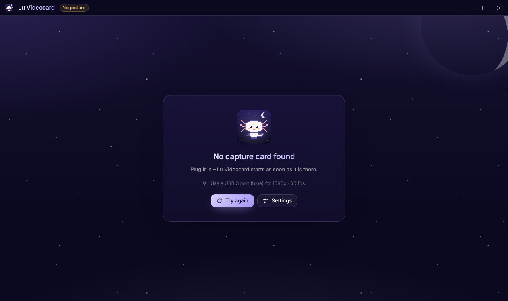
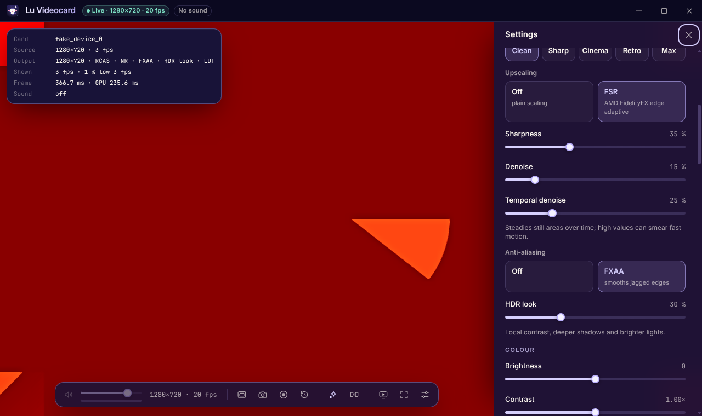
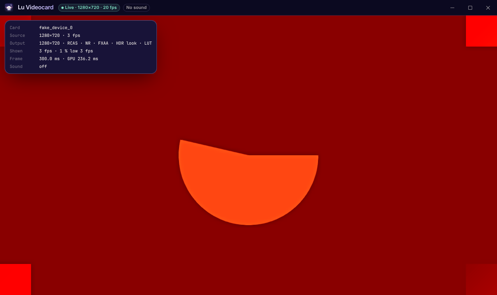
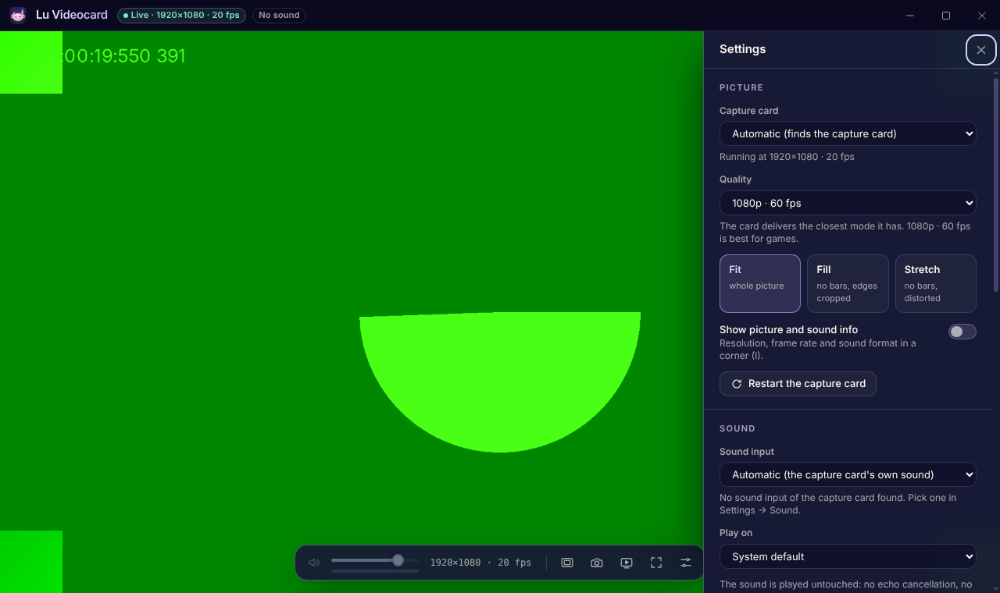

# Lu Videocard


Lu Videocard – your HDMI capture card in a window, with clean sound and a sharp picture, and a
GPU pipeline that makes the picture better: upscaling, sharpening, denoising, an HDR look,
LUTs and frame generation, plus recording and a replay buffer. Made for the BENFEI 4K HDMI →
USB-C/A capture card (1080p · 60 fps), and it works with any UVC capture card (Elgato Cam Link,
UGREEN, MS2130/MS2109 sticks, …). Part of the Luna-OS "Moon" family: the same night-sky palette
and glass surfaces as Moon Zip, Moon Code and Moon Explorer – with Axo, the Luna-OS axolotl
mascot, as its icon.



## What it does

- **Finds the capture card by itself** – not the webcam – and pairs it with its own sound input
  (same USB device). An ordinary microphone is never picked on its own, so there is no feedback.
- **Sharp picture**: asks the card for 1080p · 60 fps (or 1440p / 4K · 30 fps, 720p · 60 fps) and
  shows its own pixels without scaling (`resizeMode: none`) and without a media buffer, so the
  delay stays as low as the card allows.
- **Clean sound**: stereo at 48 kHz with **no** echo cancellation, noise suppression or automatic
  volume – the things that make game sound and music thin or pumping in video calls. Played
  through Web Audio for a low delay, with volume, mute, a live level meter and a choice of
  speaker.
- **Fullscreen without borders** (F, F11 or a double-click): the window is nothing but the picture
  – no title bar, no buttons, no frame. The controls and the mouse pointer only appear while you
  move the mouse.
- **Stream mode** (C): the same in a normal window, which also takes the picture's 16:9 shape, so
  there are no black bars. Ideal for sharing the window on Discord.
- **Fit, fill or stretch** the picture; **screenshots** in full resolution (Ctrl+S) go to
  Pictures › Lu Videocard.
- **Keeps going**: unplug the card and plug it back in – the picture comes back by itself. If
  another program (OBS, Discord's camera, the Camera app) has the card, it says so.
- **Keeps the screen on** while the picture runs, remembers the window and all settings, night and
  day theme.
- **Updates itself** from the GitHub releases (Settings › Updates).

## Enhancement (E)

Every frame runs through a GPU pipeline (WebGL2, so it works on NVIDIA, AMD and Intel alike):

| Step | What it does |
| --- | --- |
| **FSR upscaling** | AMD FidelityFX Super Resolution 1.0 (EASU): edge-adaptive upscaling to the window's size, up to 4× – a 1080p card looks sharp on a 1440p or 4K screen. |
| **Sharpening** | FSR's RCAS, contrast-adaptive so noise isn't sharpened. |
| **Denoise** | A bilateral filter for grain, and a temporal filter that steadies still areas across frames. |
| **Anti-aliasing** | FXAA against jagged edges. |
| **HDR look** | Local contrast, deeper shadows and brighter lights. |
| **Colour** | Brightness, contrast, saturation, vibrance, gamma, temperature and tint. |
| **LUT** | Any .cube LUT (the format of DaVinci Resolve and most LUT packs), with a strength slider. |

Presets – Clean, Sharp, Cinema, Retro, Max – set the whole look at once; every slider can be
changed afterwards. **E** switches the pipeline off and on for a before/after look. The
stats (**I**) show what runs and how long the GPU takes per frame.



## Frame generation (G)

A generated frame between every two real ones doubles the frame rate: 60 fps from the card
becomes 120 on screen. The motion is estimated by symmetric block matching (coarse to fine, in
three quality levels) and each pixel of the new frame is pulled from both neighbours along it;
where the two don't agree, protection blends them instead, so wrong vectors don't become
artefacts.

- It costs about half a capture frame of delay – the same as DLSS and FSR frame generation.
- It needs a screen that refreshes at least twice as fast as frames arrive (120 Hz for 60 fps);
  on a slower screen it pauses by itself and says so in the stats.
- **Drop repeated frames**: a 30 fps game on a 60 fps capture card arrives as pairs of equal
  frames. Dropping the repeats lets frame generation make real in-between frames, so the game
  runs at a smooth 60.

## Recording (F8) and replay buffer (F9)

**F8** records the picture as shown – enhanced, and with the generated frames when frame
generation is on – together with the capture card's sound, as MP4 (H.264) where Windows can
encode it, otherwise WebM, at the bitrate you pick. Files go to Videos › Lu Videocard.

The **replay buffer** keeps the last 15 seconds to 2 minutes in memory while the picture runs;
**F9** saves them to a file – for the moment that just happened.





## Sharing on Discord

1. Start Lu Videocard and press **F** (fullscreen) or **C** (stream mode).
2. In Discord: *Share your screen* → pick the window **Lu Videocard** (or your screen) and switch
   **sound** on.
3. Move the mouse away – the controls disappear and only the picture is shared.

## Keyboard

| Keys | What |
| --- | --- |
| F / F11 / double-click | Fullscreen |
| Esc | Leave fullscreen or stream mode |
| C | Stream mode (only the picture) |
| E | Enhancement on / off |
| G | Frame generation on / off |
| F8 | Start / stop recording |
| F9 | Save the replay buffer |
| F7 / Ctrl+S | Screenshot (the enhanced picture, at its output resolution) |
| M | Mute |
| ↑ / ↓ | Volume |
| I | Picture and performance info (resolution, fps, 1 % low, GPU time, sound format) |
| R | Restart the capture card |
| Ctrl+, | Settings |

## Tips for the best picture

- Plug the card into a **USB 3** port (often blue) – USB 2 only manages a lower frame rate.
- Set the console or PC that feeds the card to 1080p · 60 Hz (the card takes 4K in, but captures
  at up to 1080p · 60).
- Press **I** to see what really arrives: the mode the card delivers and the frames per second
  shown on screen.

## Install

Download `Lu-Videocard-Setup-<version>.exe` from the
[latest release](https://github.com/Luna-OS/lu-videocard/releases/latest) and run it. Later
versions arrive through the built-in updater. There is also a portable ZIP.

## Build it yourself

```sh
npm install
npm run app        # build and start
npm run dist       # Windows installer and ZIP in release/
npm test           # unit tests (vitest + node --test)
npm run icons      # render public/lu-videocard-logo.svg into build/icon.png and icon.ico
```

React + Vite + Tailwind CSS in Electron. `src/lib/devices.ts` finds the card and holds the
capture constraints, `src/lib/capture.ts` starts and restarts the streams, `src/lib/gl/` is the
GPU pipeline (shaders and the engine), `src/lib/pacer.ts` decides what each screen refresh
shows, `src/lib/recording.ts` records, and `electron/main.cjs` is the frameless window,
fullscreen, screenshots, recording files and the updater. The algorithms the shaders follow are
listed in [docs/THIRD_PARTY.md](docs/THIRD_PARTY.md).

## License

MIT – see [LICENSE](LICENSE).
