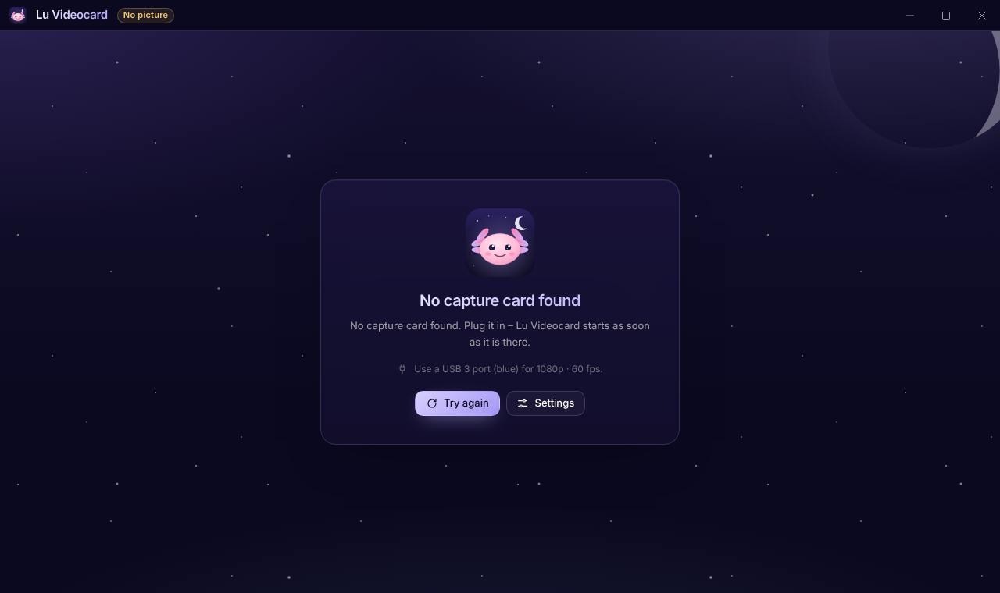
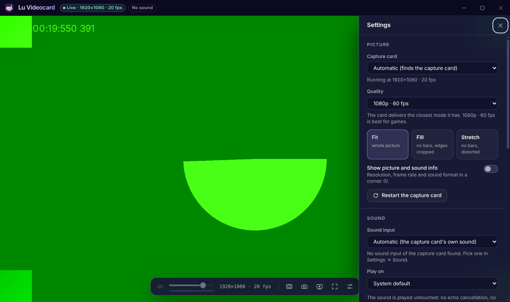

# Lu Videocard


Lu Videocard – your HDMI capture card in a window, with clean sound and a sharp picture. Made for
the BENFEI 4K HDMI → USB-C/A capture card (1080p · 60 fps), and it works with any UVC capture
card (Elgato Cam Link, UGREEN, MS2130/MS2109 sticks, …). Part of the Luna-OS "Moon" family: the
same night-sky palette and glass surfaces as Moon Zip, Moon Code and Moon Explorer – with an
axolotl as its icon.



## What it does

- **Finds the capture card by itself** – not the webcam – and pairs it with its own sound input
  (same USB device). An ordinary microphone is never picked on its own, so there is no feedback.
- **Sharp picture**: asks the card for 1080p · 60 fps (or 1440p / 4K · 30 fps, 720p · 60 fps) and
  shows its own pixels without scaling (`resizeMode: none`) and without a media buffer, so the
  delay stays as low as the card allows.
- **Clean sound**: stereo at 48 kHz with **no** echo cancellation, noise suppression or automatic
  volume – the things that make game sound and music thin or pumping in video calls. Played
  through Web Audio for a low delay, with volume, mute, a live level meter and a choice of
  speaker.
- **Fullscreen without borders** (F, F11 or a double-click): the window is nothing but the picture
  – no title bar, no buttons, no frame. The controls and the mouse pointer only appear while you
  move the mouse.
- **Stream mode** (C): the same in a normal window, which also takes the picture's 16:9 shape, so
  there are no black bars. Ideal for sharing the window on Discord.
- **Fit, fill or stretch** the picture; **screenshots** in full resolution (Ctrl+S) go to
  Pictures › Lu Videocard.
- **Keeps going**: unplug the card and plug it back in – the picture comes back by itself. If
  another program (OBS, Discord's camera, the Camera app) has the card, it says so.
- **Keeps the screen on** while the picture runs, remembers the window and all settings, night and
  day theme.
- **Updates itself** from the GitHub releases (Settings › Updates).



## Sharing on Discord

1. Start Lu Videocard and press **F** (fullscreen) or **C** (stream mode).
2. In Discord: *Share your screen* → pick the window **Lu Videocard** (or your screen) and switch
   **sound** on.
3. Move the mouse away – the controls disappear and only the picture is shared.

## Keyboard

| Keys | What |
| --- | --- |
| F / F11 / double-click | Fullscreen |
| Esc | Leave fullscreen or stream mode |
| C | Stream mode (only the picture) |
| M | Mute |
| ↑ / ↓ | Volume |
| Ctrl+S | Screenshot |
| I | Picture and sound info (resolution, frame rate, sound format) |
| R | Restart the capture card |
| Ctrl+, | Settings |

## Tips for the best picture

- Plug the card into a **USB 3** port (often blue) – USB 2 only manages a lower frame rate.
- Set the console or PC that feeds the card to 1080p · 60 Hz (the card takes 4K in, but captures
  at up to 1080p · 60).
- Press **I** to see what really arrives: the mode the card delivers and the frames per second
  shown on screen.

## Install

Download `Lu-Videocard-Setup-<version>.exe` from the
[latest release](https://github.com/Luna-OS/lu-videocard/releases/latest) and run it. Later
versions arrive through the built-in updater. There is also a portable ZIP.

## Build it yourself

```sh
npm install
npm run app        # build and start
npm run dist       # Windows installer and ZIP in release/
npm test           # unit tests (vitest + node --test)
npm run icons      # render public/lu-videocard-logo.svg into build/icon.png and icon.ico
```

React + Vite + Tailwind CSS in Electron. `src/lib/devices.ts` finds the card and holds the
capture constraints, `src/lib/capture.ts` starts and restarts the streams, `electron/main.cjs` is
the frameless window, fullscreen, screenshots and the updater.

## License

MIT – see [LICENSE](LICENSE).
